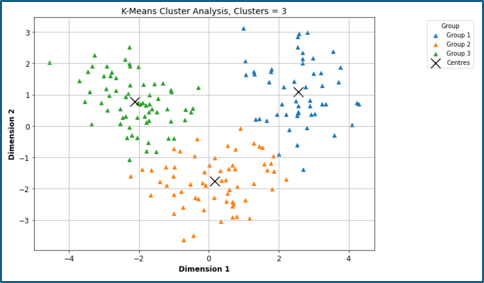
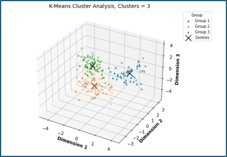

## Foreword:
Whilst this Readme demonstrates outputs using a wine measurements dataset example, the KMEANS class is general and has been robustly built to handle any pre-cleaned (and potentially dimensionality-reduced) dataset.

## Purpose: 
KMEANS runs an algorithm that sorts observations into clusters based on their explanatory variable responses. The targeted number of clusters is chosen by the user. 

Whilst KMEANS can generally be performed for any number of explanatory variables, the clusters can only be visualised graphically using two or three dimensions, which is what this class allows. 

K-means has many real-world applications including customer segmentation, outlier detection and medical diagnostics. 

## Input:
The dataset must have been cleaned using the companion DataCleaning class from the repository before creating an instance of the KMEANS class. Unless there are only two or three features, using the companion PCA class beforehand is also recommended, in order to reduce the dimensionality whilst retaining most of the variation in the data.

Creating an instance of the KMEANS class requires inputting the dataset in the form of a NumPy array, as well as entering the required number of clusters (must be at least 2) and the number of dimensions to plot (must be 2 or 3, defaulted to 2). There is also an option to insert a random seed (`random_state`). If this isn’t left as `None`, Python’s random number generator will pick identical starting coordinates for the cluster centres whenever it runs the algorithm on the same dataset.

If the dataset isn’t in the form of a NumPy array, e.g. a list or tuple, the `__init__` method will convert it to a NumPy array using `np.asarray()`.

Input checks are performed that ensure
* The array is 2-dimensional
* At least two clusters are being looked for
* The dimensions to plot is 2 or 3
* The number of columns isn’t less than the dimensions to plot

## Methods:

### 1. `fit`
*(Must be run before the plot method)*

Applies the `kmeans2` algorithm from the `scipy.cluster.vq` library. All columns in the input array are used in the algorithm, even if only the leading two or three are plotted.

Note the following two arguments on `kmeans2`:
* `minit="++"` – ensures cluster centres are selected carefully. Prevents starting centre positions being chosen that are too close or too far away.
* `seed=self.random_state` – if `random_state` is specified when creating an object in the class, makes sure the same result is reproduced for repeated applications of the algorithm to the same dataset.

### 2. `plot`
*(Must be run after the fit method)*

Depending on how many dimensions are chosen to be plotted when the object is created, the plot method produces a 2D or 3D plot of the leading two or three columns. Different clusters or groups are represented by different colour data points. Cluster centres are marked with an X.

Plots for the wine dataset are provided beneath as examples. As it is known there are three wine types, three clusters are selected. The first four principal components are used, but only the first two or three are shown on the graphs.





### 3. `print_centres_labels`
Prints the coordinates of the cluster centres as well as the label (or cluster number) for each observation.

## Library functions required:
```python
from scipy.cluster.vq import kmeans2
import numpy as np
import matplotlib.pyplot as plt
```

## Using the fit and plot methods for the wine measurement data
```python
# Perform PCA on the cleaned data, convert the principal components matrix to a Numpy
# array and take the first 4 principal components
pca_engine = PCA(pd.read_csv("cleaned_data.csv")).fit_transform()   
X_projected = pca_engine.Z.to_numpy() 
X_projected_top = X_projected[:, :4]
# Create an instance of the class and chain the methods fit and plot
k_means = KMEANS(X_projected_top, clusters=3, dimensions_to_plot=3).fit().plot()
```

## Useful extension
* Adding a slider to rotate the 3D plot
