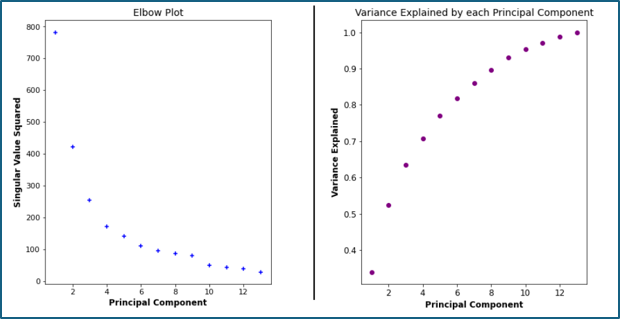
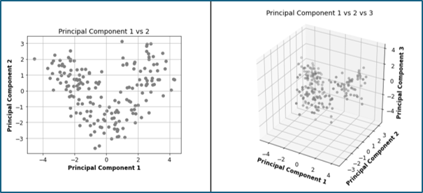
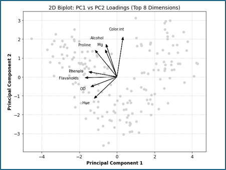

## Foreword:
Whilst this Readme demonstrates some outputs using a wine measurements dataset example, the `PCA` class is general and has been robustly built to handle any pre-cleaned dataset.

## Purpose:
The primary purpose of Principal Components Analysis is to reduce the dimensionality of a dataset. Simplifying the number of features into a smaller number of dimensions that still includes most of the same variation makes subsequent modelling such as regression or K-means clustering much more straightforward.

## Input:
The input dataset should be in the form of a Pandas DataFrame and created as an instance of the `PCA` class. It should have been passed through the companion `DataCleaning` class beforehand.

As part of the initialisation method, a copy of the DataFrame is taken to prevent `SettingWithCopy` warnings. Empty arrays are created for the centred and scaled dataset, the output of the Singular Value Decomposition (SVD), as well as the principal components matrix.

Besides initialisation, there are seven methods. Some perform the PCA itself, whilst others aid the determination of how many principal components (dimensions) to select. The final biplot method shows how the initial features are represented by the principal components. 

Note that methods 1-3 can be performed together as a chain in method 4, saving processing effort.

## Methods:

### 1. `centre_scale_dataset`
The first step is to centre and scale the pre-cleaned input dataset. In terms of the code

$$\bar{X} = \frac{X - X.\text{mean}()}{X.\text{std}()}$$

Where X̄ is the centred and scaled dataset and X is the input. Every value has its column mean subtracted from it and the result is then divided by the column standard deviation. This is performed using the Pandas library.

The reason for this is to stop the PCA process prioritising features that have higher absolute values and variation.

### 2. `SVD`
This method comes from the `numpy.linalg` library. The centred and scaled dataset, X̄, is decomposed into the following three arrays
* U - the eigenvectors of $$\bar{X}\bar{X}^T$$
* s - the singular values
* VT - V gives the eigenvectors of $$\bar{X}^T\bar{X}$$, the covariance matrix of X̄. VT is the transpose of V

The `full_matrices=False` argument is used for SVD to save memory and computation time.

### 3. `transform`
The transformation of X̄ to obtain the PCA matrix, Z, is

$$Z = \bar{X}V$$

Where V is the transpose of $$V^T$$ from the second method. This transformation projects X̄ onto the basis of the eigenvectors in V, rotating it so that it points in the directions of maximum variance. This allows the selection of only the principal components that explain the majority of the variation in the original dataset.

There is another way to think about this. By finding a transformation to X̄ that would make the covariance matrix diagonal and equal to the singular values squared, inter-column variances and multicollinearity would be eliminated. If there is only within-column variances, just the handful of new dimensions with the highest variation can be included in subsequent analysis.

A short mathematical proof of how X̄V is the projection that means the covariance matrix will be diagonal and equal to the singular values squared is given below as an aside

If Z is the matrix that is a transformation of X̄, we require that

$$Z^T Z = s^2$$

Using the transformation Z = X̄V

$$(\bar{X}V)^T(\bar{X}V) = s^2 \implies V^T \bar{X}^T \bar{X} V = s^2$$

As $$\bar{X} = U \Sigma V^T$$ (Singular Value Decomposition)

$$V^T (U \Sigma V^T)^T (U \Sigma V^T) V = s^2 \implies V^T V \Sigma^T U^T U \Sigma V^T V = s^2$$

Because V and U are semi-orthogonal, $$V^T V = U^T U = I$$, and the two sides are equal.

### 4. `fit_transform` (master method)
The first three methods packaged into one for simpler processing.

### 5. `elbow_var_explained_plots`
This method produces a side-by-side ‘elbow plot’ and ‘variance explained by each principal component’ plot. They inform the selection of how many principal components to adopt.

* **Elbow plot:** this displays the singular values squared (proportional to variance) for each component in descending order. Components are selected up to the point where the difference in vertical height between successive plotted points starts to become small (the elbow point).  
* **Variance Explained by Each Principal Component:** an alternate presentation of the elbow plot, plotting the cumulative variance explained for each component. To translate the singular value into variances

$$\text{Var} = \frac{s^2}{\text{degrees of freedom}}$$

Where

$$\text{degrees of freedom} = \text{rows of data} - 1$$

When selecting the number of principal components / dimensions to use, a balance must be found between retaining sufficient variation in the data and being able to adequately reduce its dimensionality. The output for the wine measurement dataset is



The elbow point on the left figure appears to be at about the fourth principal component, with the points starting to flatten out afterwards, implying the selection of four components. The variance explained figure on the right confirms this is the optimum amount, as four components would retain a strong >70% of variation in the data vs only 60-65% for three components.

### 6. `components_plot`
2D and 3D scatterplots are produced, plotting the coordinate of each observation on the new eigenvector basis for the top 2 or 3 principal components. That is, principal component 1 vs principal component 2 and principal component 1 vs principal component 2 vs principal component 3. There is a defensive block of code to only show the 2D graph if the underlying data has 2 dimensions. 

These plots are helpful in a number of ways. They can indicate possible clusters and groupings in the data, which is of particular use for the complementary KMEANS class. In addition, it’s much easier to spot outliers in 2D or 3D compared to large numbers of columns, and the plots can detect any nonlinear relationship between the components.

For the wine measurement dataset



Note the V-shape in the 2-dimensional plot, demonstrating a non-linear relationship between principal components 1 & 2. It’s not straightforward to determine the boundaries of any clusters in the 2D plot, but that changes when three components are considered in the right figure. There is a gap in the middle of the data points and a clear cluster to the right. The data points to the left may split into two clusters.

There are no obvious outliers, but that was to be expected as outlier values were clipped in the prerequisite DataCleaning class. 

### 7. `biplot`
This is a really useful final 2D plot that relates the principal components back to the original features. The rows of the SVD matrix $$V$$, the eigenvectors of $$\bar{X}^T\bar{X}$$, give the coordinates of each of the original features in the principal component directions. For just principal components 1 & 2, there is a 2D coordinate for each feature. By overlaying these coordinates as vector arrows starting at the origin on the 2D component plot from the previous method, it is possible to see how each data point in the new 2D view scored on the original features, and which had the greatest influence.

Note that the plot will only show up to 8 original features that had the most influence on the principal components.

For the wine measurement dataset



The magnitude of the arrow vector indicates how strongly they are represented in the top two principal components. In quadrant 2 (top left) the wines have high values of alcohol, proline and phenols. In quadrant 3 (bottom left), the wines have high values of OD and Hue. It’s interesting that there are no arrows to the right but plenty of datapoints. These have very low values of the features that have arrows pointing to the left.

## Library functions required:
```python
import pandas as pd
import numpy as np
from numpy.linalg import svd
import matplotlib.pyplot as plt
from matplotlib.lines import Line2D
```

## Useful extensions
* Adding rotation sliders for the 3D scatterplots
